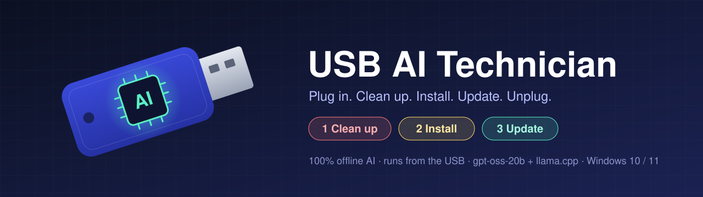
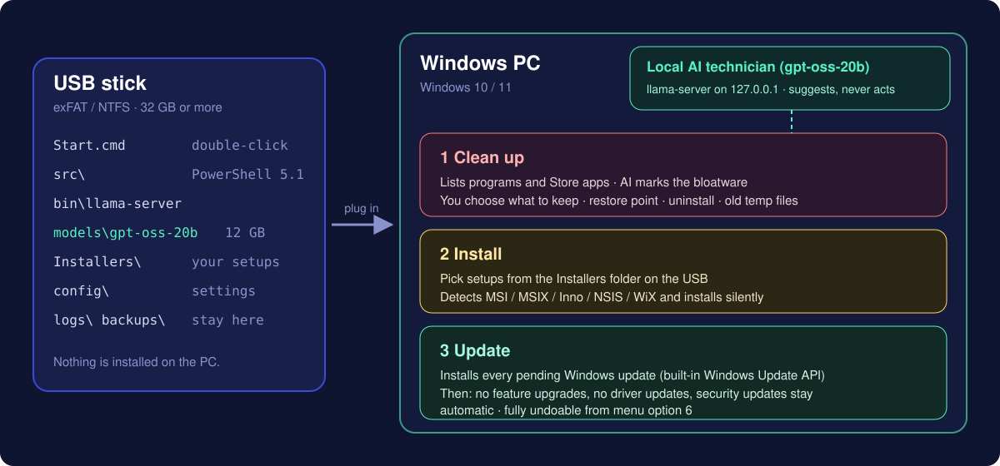
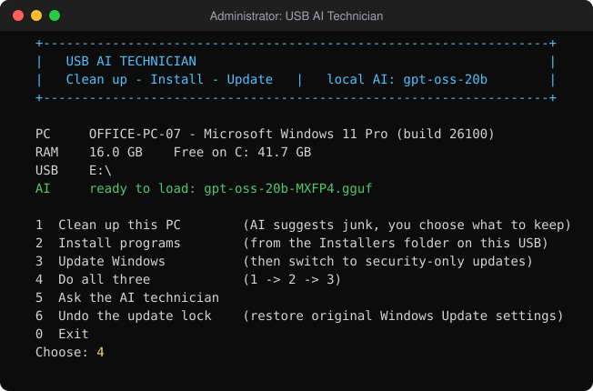
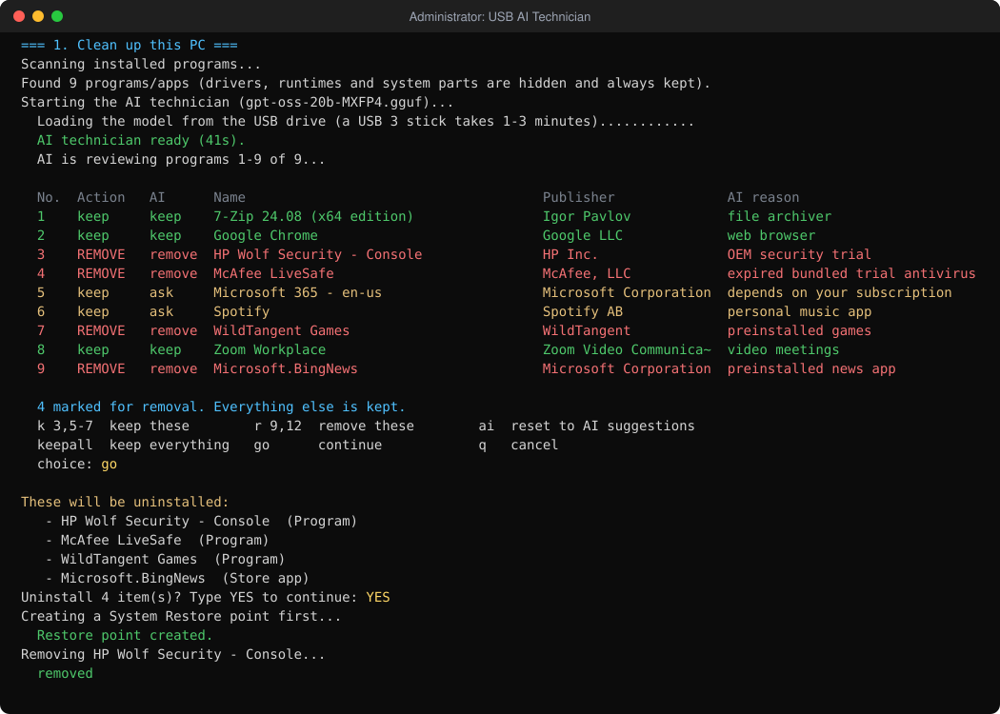
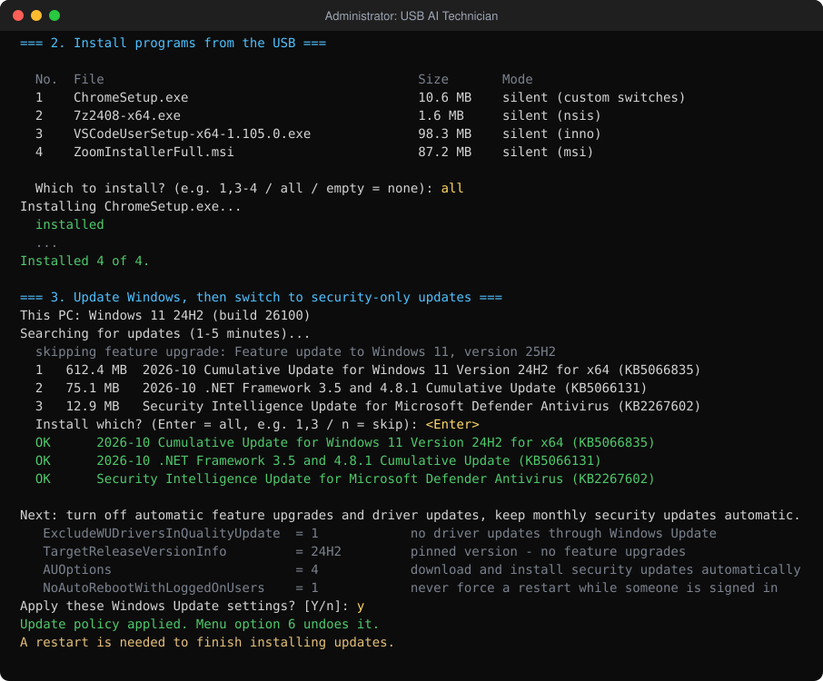

<p align="center">
  
</p>

<p align="center">
  <a href="README.he.md"><b>🇮🇱 קראו בעברית</b></a> ·
  <a href="#quick-start">Quick start</a> ·
  <a href="#what-it-does">What it does</a> ·
  <a href="#safety">Safety</a> ·
  <a href="#faq">FAQ</a>
</p>

<p align="center">
  
  
  
  
  <a href="LICENSE"></a>
</p>

**USB AI Technician** is a portable PC-maintenance tool that lives entirely on a USB stick.
Plug it into any Windows PC, double-click `Start.cmd`, and it will:

1. **Clean up the PC.** It lists the installed programs, has a local AI flag the bloatware, **asks you which programs to keep**, uninstalls the rest and clears old temp files.
2. **Install programs** you keep in the `Installers` folder on the USB, silently when possible.
3. **Update Windows**, then **switch off automatic updates except security updates**.

The AI is [OpenAI's gpt-oss-20b](https://huggingface.co/openai/gpt-oss-20b). It runs **locally from the USB** through
[llama.cpp](https://github.com/ggml-org/llama.cpp) and is reachable only on `127.0.0.1`. Nothing is installed on the PC, and the tool
keeps its own files (logs, backups, scratch files) on the USB.

<p align="center">
  
</p>

---

## Screenshots

| Main menu | Cleanup: the AI suggests, you decide |
|---|---|
|  |  |

<p align="center">
  <br>
  <sub>Installing from the USB, then updating Windows and locking it to security-only updates.</sub>
</p>

> The screenshots are generated from the tool's real output format (`tools/New-TerminalSvg.ps1`) with example programs.

---

## Quick start

### What you need

| | |
|---|---|
| **USB stick** | 32 GB or more, **exFAT or NTFS** (FAT32 cannot hold the 12 GB model), USB 3 recommended |
| **Target PC** | Windows 10 or 11, x64 or ARM64, administrator rights |
| **For the AI** | 16 GB RAM or more. The tool also works without AI on smaller PCs (`Start.cmd -NoAI`) |

### 1. Prepare the USB (once, on your own PC)

```powershell
# Option A: clone onto the USB (E: here)
git clone https://github.com/dor2500/usb-ai-technician.git E:\usb-ai-technician
# Option B: download the ZIP from GitHub (Code -> Download ZIP) and extract it onto the USB
```

Then run **`Setup-USB.cmd`** from the USB. It:

* downloads the newest **llama.cpp** Windows build (Vulkan, so it works on NVIDIA, AMD and Intel GPUs and falls back to the CPU) into `bin\`
* downloads **gpt-oss-20b** (`gpt-oss-20b-MXFP4.gguf`, ~12 GB) into `models\` and can resume if interrupted
* checks both downloads with **SHA-256**

```powershell
Setup-USB.cmd               # default: Vulkan build + model
Setup-USB.cmd -Backend cpu  # CPU-only build
Setup-USB.cmd -Force        # re-download / update llama.cpp and the model
```

### 2. Add your installers

Copy the setup files you want to offer (`.exe`, `.msi`, `.msix`, ...) into the **`Installers`** folder.
See [Installers/README.md](Installers/README.md) for custom silent switches.

### 3. Use it on any PC

Plug in the USB and double-click **`Start.cmd`**. It asks for administrator rights and opens the menu:

```
  1  Clean up this PC        (AI suggests junk, you choose what to keep)
  2  Install programs        (from the Installers folder on this USB)
  3  Update Windows          (then switch to security-only updates)
  4  Do all three            (1 -> 2 -> 3)
  5  Ask the AI technician
  6  Undo the update lock    (restore original Windows Update settings)
```

Command-line options:

```powershell
Start.cmd -Action All          # run 1 -> 2 -> 3 without the menu
Start.cmd -Action Cleanup      # also: Install, Update, UndoUpdateLock, Chat
Start.cmd -NoAI                # skip the model (PCs with little RAM)
Start.cmd -DryRun              # look around and see what WOULD happen; changes nothing
```

---

## What it does

### 1. Clean up

* Reads the installed programs from the registry (64-bit, 32-bit and per-user) plus removable **Microsoft Store apps**.
* **Drivers, runtimes and system components are never offered for removal.** This includes Visual C++ redistributables, .NET,
  WebView2, GPU, chipset and audio drivers, and Defender. The list is in [`config/protected.json`](config/protected.json).
* **gpt-oss-20b** reviews the list in batches and labels each entry `remove` (OEM bloat, trialware, toolbars, junk
  "optimizers", ...), `keep` or `ask`, with a short reason.
* You get a colour-coded table, and **you choose what to keep**:
  `k 3,5-7` keep · `r 9` remove · `ai` reset to the AI's suggestion · `keepall` · `go`
* You confirm by typing `YES`. The tool then creates a **System Restore point** and uninstalls silently where possible
  (`QuietUninstallString`, `msiexec /x {GUID} /qn`). Other programs open their own uninstaller for you to click through.
* At the end it offers to delete **temp files older than one day**. Files in use are skipped.

### 2. Install from the USB

* Scans `Installers\` and detects the installer technology: **MSI, MSIX/AppX, Inno Setup, NSIS, WiX Burn**.
* Installs silently with the right switches, or opens the normal setup window when the type is unknown.
* `Installers\installers.json` lets you set exact switches per file (wildcards supported).
* Reports exit codes in plain words (`installed`, `restart needed`, `cancelled by user`, ...).

### 3. Update Windows, then security only

Step 1 installs everything that is pending, using the **Windows Update Agent API built into Windows** (no PowerShell modules to
install). Feature upgrades to a new Windows version are skipped by default.

Step 2 sets these Windows Update **policies**:

| Policy value | Set to | Effect |
|---|---|---|
| `TargetReleaseVersion` + `ProductVersion` + `TargetReleaseVersionInfo` | e.g. `Windows 11` / `24H2` | Stays on the current Windows version, with **no feature upgrades** |
| `ExcludeWUDriversInQualityUpdate` | `1` | **No driver updates** through Windows Update |
| `AU\NoAutoUpdate` / `AU\AUOptions` | `0` / `4` | Monthly **security (cumulative) updates stay automatic** |
| `AU\ScheduledInstallDay` / `Time` | every day / 03:00 | When they install |
| `AU\NoAutoRebootWithLoggedOnUsers` | `1` | **No forced restarts** while someone is signed in |

The original values are saved to `backups\update-policy-<PC name>.json` **on the USB**. Menu option **6** puts them back exactly.

Want automatic updates **completely off** instead? Set `"mode": "ManualOnly"` in [`config/settings.json`](config/settings.json).

> Windows 10/11 no longer ships separate "security-only" packages. Security fixes come in the monthly cumulative update, which this
> mode keeps automatic. Feature upgrades, driver updates and forced restarts are what it turns off.

### 4. Ask the AI technician

A chat with gpt-oss-20b about the PC, for example "why is my PC slow?" or "what is this program?". It answers in the language you write in (Hebrew works).
It can only give advice. It cannot run anything.

---

## How the AI is used (and limited)

```
Start.cmd ─► PowerShell 5.1 (src\Main.ps1)
               │
               ├─► bin\llama-server.exe  -m models\gpt-oss-20b-MXFP4.gguf  --host 127.0.0.1 --port <random>
               │        ▲  OpenAI-compatible /v1/chat/completions, local only
               │        │
               └── asks "remove / keep / ask?" ──► parses JSON ──► shows YOU a table ──► YOU confirm
```

* The model **only produces suggestions**. Uninstalls, installs and registry changes are made by plain PowerShell code, and only after you confirm.
* Its output is parsed strictly: unknown IDs are ignored and unclear answers become `ask`.
* It is loaded only when needed and **unloaded right after the review**, which frees ~12 GB of RAM before uninstallers and updates run.
* Reasoning effort is `low` by default to keep it fast on ordinary PCs (`llm.reasoningEffort` in settings).

---

## Safety

* ✅ **Restore point** before uninstalling and before installing updates
* ✅ You type **`YES`** before anything is uninstalled
* ✅ **Protected list**: drivers, runtimes and security software are never offered for removal
* ✅ **`-DryRun`** shows exactly what would happen without changing anything
* ✅ **Undo** for the Windows Update policy (menu 6), with the original values backed up on the USB
* ✅ **Session log** of every action in `logs\` on the USB
* ✅ The AI cannot execute anything, and it listens on `127.0.0.1` only

Use it only on computers you own or are allowed to administer. Uninstalling software is permanent apart from the restore point.

### What stays where

| Written to the **USB** | Changed on the **PC** (only what you confirm) |
|---|---|
| `logs\` session logs, llama-server logs | Programs you chose to uninstall or install |
| `backups\` original Windows Update settings per PC | Windows updates |
| `temp\` scratch files (emptied on exit) | Windows Update policy values (undoable) |
| | A System Restore point |

---

## Configuration

| File | What it controls |
|---|---|
| [`config/settings.json`](config/settings.json) | Model file, context size, reasoning effort, restore points, Store apps on/off, update mode (`SecurityOnly` / `ManualOnly`) |
| [`config/protected.json`](config/protected.json) | Regex lists of programs/apps that are never offered for removal |
| `Installers/installers.json` | Per-file silent switches ([example](Installers/installers.example.json)) |

Any other GGUF model works too: drop it in `models\` and set `llm.modelFile`.

---

## Project layout

```
usb-ai-technician/
├── Start.cmd                  ← double-click on the target PC (elevates to admin)
├── Setup-USB.cmd              ← run once to download llama.cpp + gpt-oss-20b
├── src/
│   ├── Main.ps1               menu and command line
│   ├── Setup-USB.ps1          downloader with SHA-256 verification
│   └── lib/
│       ├── Common.ps1         session, logging, input parsing, dry-run aware process runner
│       ├── Llm.ps1            llama-server lifecycle, chat client, JSON extraction, AI review
│       ├── Cleanup.ps1        program discovery, protection, selection UI, uninstall, temp files
│       ├── Installers.ps1     installer detection and silent install
│       └── WindowsUpdate.ps1  Windows Update API, security-only policy, backup and undo
├── config/                    settings.json, protected.json
├── Installers/                your setup files (git-ignored)
├── bin/  models/              filled by Setup-USB (git-ignored)
├── tests/Run-Tests.ps1        dependency-free tests, incl. a fake llama-server
├── tools/New-TerminalSvg.ps1  renders the README screenshots
└── docs/                      images and screen sources
```

---

## Development

```powershell
.\tests\Run-Tests.ps1                      # 29 tests, Windows PowerShell 5.1 and PowerShell 7
.\Start.cmd -DryRun -NoAI                  # safe end-to-end run on your own PC
```

GitHub Actions runs the tests on both PowerShell versions, plus PSScriptAnalyzer, on every push.
All scripts are plain ASCII and target **Windows PowerShell 5.1**, which ships with every Windows 10/11, so the USB needs no runtime.

---

## FAQ

<details>
<summary><b>Setup says the drive is FAT32</b></summary>

FAT32 cannot store files over 4 GB and the model is ~12 GB. Back up the USB, format it as **exFAT** (right-click the drive →
Format → exFAT), copy the project back and run `Setup-USB.cmd` again.
</details>

<details>
<summary><b>Windows SmartScreen / "Windows protected your PC"</b></summary>

Files downloaded as a ZIP are marked as coming from the internet. Click *More info → Run anyway*, or unblock them once:
`Get-ChildItem -Recurse E:\ | Unblock-File`.
</details>

<details>
<summary><b>The AI is very slow or does not start</b></summary>

gpt-oss-20b needs about 16 GB of RAM. On smaller PCs use `Start.cmd -NoAI`: all three features work without it, you simply
pick what to remove yourself. The first load from a USB 2 stick can take several minutes. See `logs\llama-server.err.log` for details.
</details>

<details>
<summary><b>Settings says "Some settings are managed by your organization"</b></summary>

That is how Windows shows the update policies from step 3. Menu option **6** removes them.
</details>

<details>
<summary><b>Does the update lock work on Windows Home?</b></summary>

The version pin (`TargetReleaseVersion`) and driver exclusion are officially supported on Pro, Enterprise and Education. Windows
Home may ignore some of them. Automatic security updates keep working either way.
</details>

<details>
<summary><b>Does it need internet?</b></summary>

The AI does not. Windows Update obviously does, and `Setup-USB.cmd` needs it once to download llama.cpp and the model.
</details>

---

## Credits & license

* [gpt-oss-20b](https://huggingface.co/openai/gpt-oss-20b) by OpenAI, Apache-2.0. GGUF conversion by [ggml-org](https://huggingface.co/ggml-org/gpt-oss-20b-GGUF)
* [llama.cpp](https://github.com/ggml-org/llama.cpp), MIT
* This project: [MIT](LICENSE)

Provided as-is, without warranty. You are responsible for the changes you confirm on a computer.
